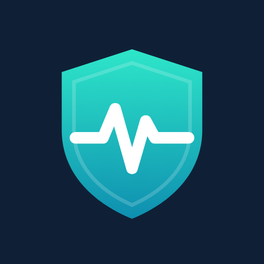

<p align="center">
  
</p>

<h1 align="center">WG VPN cho iPhone & iPad</h1>

<p align="center">Ứng dụng VPN WireGuard / AmneziaWG cho <b>iOS và iPadOS</b> (iOS 16 trở lên),<br/>
bản chuyển từ <a href="https://github.com/xuanthanhtnt/Wireguard">WG VPN cho Android</a>, giữ nguyên tính năng <b>tự giám sát máy chủ</b>.</p>

---

## Tải và cài đặt

**Tải IPA mới nhất:** https://github.com/xuanthanhtnt/Wireguard-IOS-PasOS/releases/latest — file `WGVPN-1.0.N.ipa`.

Ứng dụng VPN trên iOS cần quyền **Network Extension** của Apple. Vì vậy:

| Cách cài | VPN hoạt động? | Ghi chú |
|---|---|---|
| **TrollStore** (iOS 14.0 – 16.6.1, 16.7 RC, 17.0) | ✅ | Mở file `.ipa` bằng TrollStore là xong. File đã được ký ad-hoc kèm quyền cần thiết. |
| **Sideloadly / AltStore / SideStore / ESign** với **tài khoản Apple Developer trả phí** (99 USD/năm) | ✅ | Công cụ sẽ ký lại bằng chứng chỉ của bạn. Bật “Network Extensions” và “App Groups” cho App ID. |
| Sideloadly / AltStore với **Apple ID miễn phí** | ❌ | Apple không cấp quyền Network Extension cho tài khoản miễn phí: ứng dụng mở được nhưng không bật được VPN. |
| **Ký sẵn trên GitHub Actions** (xem bên dưới) | ✅ | Có thêm file `WGVPN-1.0.N-signed-*.ipa` cài trực tiếp (ad-hoc/development) hoặc gửi TestFlight. |

> Một file `.ipa` dùng chung cho **iPhone và iPad** (giao diện chia đôi trên iPad), chạy được cả trên máy Mac chip Apple khi cài qua TestFlight/App Store.

**Cập nhật:** tab *Giới thiệu › Kiểm tra cập nhật* tìm bản mới trên trang Releases; ứng dụng cũng tự kiểm tra mỗi ngày và báo bằng thông báo. Mỗi lần build, số phiên bản tự tăng: `1.0.<số build>`.

## Tính năng

### Giống bản Android (WG Tunnel 5.8.1)
- Nhập cấu hình từ file `.conf`, file zip, **mã QR** (camera hoặc ảnh), URL, bộ nhớ tạm, hoặc tạo thủ công (tự tạo cặp khóa); xuất file `.conf`, mã QR
- Hỗ trợ **WireGuard** và **AmneziaWG** (chống DPI: Jc, Jmin, Jmax, S1–S4, H1–H4, I1–I5…)
- **Tự động bật/tắt tunnel** theo Wi-Fi (mạng tin cậy theo SSID), dữ liệu di động, mạng khác (Ethernet trên iPad) — dùng On-Demand của iOS nên hoạt động cả khi ứng dụng đóng
- **Kill switch** (chặn mọi kết nối ngoài VPN), tùy chọn cho phép mạng LAN
- **DNS mã hóa** (DoH / DoT) theo từng tunnel
- Thống kê trực tiếp (bắt tay gần nhất, dữ liệu nhận/gửi), nhật ký
- **Khóa ứng dụng** bằng Face ID / Touch ID / mật mã
- **Sao lưu / khôi phục** tất cả tunnel (zip)
- Điều khiển từ xa: thao tác **Phím tắt (Shortcuts) & Siri** “Bật tunnel / Tắt tunnel / Bật‑tắt tunnel / Kiểm tra máy chủ”, liên kết `wgvpn://connect?name=…`, `wgvpn://disconnect`, `wgvpn://toggle?name=…`, `wgvpn://check`
- Mở file `.conf`/`.zip` từ Tệp, AirDrop, Mail… thẳng vào WG VPN

### Giám sát máy chủ — tab *Giám sát* (hoặc *Cài đặt › WG VPN › Giám sát máy chủ*)

**1. Tự cập nhật IP máy chủ khi IP thay đổi**
- Định kỳ (1–30 phút) tra cứu lại tên miền máy chủ **bên ngoài tunnel**: DNS của mạng thật (gắn vào Wi‑Fi/di động bằng DNS‑SD) + DNS‑over‑HTTPS Cloudflare/Google.
- Khi máy chủ khởi động lại và nhận IP mới, WG VPN **chuyển peer sang IP mới ngay trong tunnel đang chạy** (không ngắt kết nối) và ghim IP mới 15 phút cho lần bật sau (tránh bộ nhớ đệm DNS cũ).
- Endpoint là **địa chỉ IP cố định**: gán cho tunnel một **tên miền DDNS** (vd. `nhacuatoi.duckdns.org`) hoặc **URL trả về IP** — khi nguồn này đổi IP, Endpoint trong cấu hình được **ghi lại IP mới** tự động.
- Kiểm tra ngay khi tunnel bắt đầu bắt tay thất bại; an toàn với mạng LAN dùng DNS nội bộ (split‑horizon).

**2. Tạm ngắt VPN khi máy chủ bị cúp điện — để không mất Internet**
- Khi tunnel bắt tay thất bại liên tục quá thời gian đặt (45 giây – 5 phút) **trong khi Internet của máy vẫn hoạt động** (kiểm tra trực tiếp bên ngoài tunnel), WG VPN thử bắt tay lại một lần nữa rồi mới **tạm ngắt**.
- Trên iOS, tạm ngắt nghĩa là tunnel vẫn chạy nhưng **không định tuyến gì** (chế độ “passthrough”): mọi kết nối đi thẳng ra Internet, còn WG VPN vẫn ở trong nền để **kiểm tra máy chủ** (1–15 phút một lần, hoặc ngay khi đổi mạng / máy thức dậy):
  - *Thử bắt tay VPN*: gửi gói bắt tay và chờ trả lời — chính xác nhất, **không làm gián đoạn Internet**.
  - *Ping máy chủ* (ICMP hoặc cổng TCP tùy chọn).
- Khi máy chủ có điện trở lại, VPN **tự định tuyến lại** và thông báo. Thông báo có nút *Kết nối lại ngay* / *Hủy chờ*.
- Không tạm ngắt khi máy mất mạng, đang ngủ hay bị cổng đăng nhập Wi‑Fi chặn. Trạng thái tạm ngắt được lưu lại.
- Tunnel bật **Kill switch**: iOS buộc mọi gói tin vào tunnel nên không thể “passthrough”. Nếu bật *Tạm bỏ Kill switch khi đang ngắt*, WG VPN tắt hẳn VPN (Internet vẫn dùng được), tạm dừng On‑Demand, và kiểm tra lại máy chủ khi bạn mở ứng dụng, khi iOS cho chạy nền, hoặc khi bấm *Kết nối lại ngay*.

Mọi sự kiện (đổi IP, tạm ngắt, kết nối lại) được ghi vào **Nhật ký** trong màn hình Giám sát máy chủ.

### Khác biệt so với Android (do giới hạn của iOS)
| Android | iOS |
|---|---|
| Chia tách ứng dụng (split tunneling theo app) | Không có — iOS chỉ cho phép VPN theo ứng dụng qua MDM |
| Chế độ Proxy (SOCKS5/HTTP) | Không có |
| Ký tự đại diện trong SSID | iOS chỉ so khớp đúng tên mạng |
| Multihop (tunnel vào → tunnel ra) | Mỗi lúc chỉ một VPN chạy; dùng cấu hình nhiều peer/AllowedIPs |
| Ô Cài đặt nhanh, lối tắt màn hình chính | Phím tắt (Shortcuts) — có thể thêm vào Trung tâm điều khiển / màn hình chính |
| Khóa bằng PIN | Face ID / Touch ID / mật mã máy |
| Android TV | — |

## Hướng dẫn nhanh tính năng mới
1. Nhập cấu hình WireGuard như bình thường (nút **+**), cho phép WG VPN thêm cấu hình VPN và gửi thông báo.
2. Endpoint là **tên miền DDNS**: không cần làm gì thêm — tự cập nhật IP bật sẵn.
3. Endpoint là **IP**: vào *Giám sát › Nguồn IP theo từng tunnel*, chạm tunnel và nhập tên miền DDNS của router/máy chủ (DuckDNS, No‑IP, ASUS DDNS…) hoặc URL trả về IP. Nếu máy chủ không có DDNS thì không có cách nào để điện thoại biết IP mới — hãy bật DDNS trên router.
4. Bấm **Kiểm tra ngay** để xem IP mà máy chủ đang trỏ tới.

## Build

### Cách 1 — GitHub Actions (không cần máy Mac)
1. Mỗi lần đẩy mã lên nhánh `main`, workflow **Build WG VPN IPA** chạy trên máy macOS của GitHub (miễn phí cho repo công khai), hoặc bấm *Run workflow* trong tab **Actions**.
2. Sau ~5–10 phút, tải IPA trong mục **Artifacts** của lần chạy, hoặc trang **Releases** (`v1.0.N`).

**Ký sẵn IPA (tùy chọn, cần Apple Developer trả phí):**
1. Trên developer.apple.com tạo 2 App ID: `com.tencuaban.wgvpn` và `com.tencuaban.wgvpn.network-extension`, bật **Network Extensions** và **App Groups** (group `group.com.tencuaban.wgvpn`) cho cả hai.
2. Tạo chứng chỉ (Apple Development / Distribution), xuất `.p12`; tạo 2 provisioning profile (Ad Hoc hoặc Development, kèm UDID máy của bạn).
3. Thêm vào *Settings › Secrets and variables › Actions*:
   - `IOS_CERTIFICATE_P12_BASE64` = `base64 -i cert.p12`
   - `IOS_CERTIFICATE_PASSWORD`
   - `IOS_PROFILE_APP_BASE64` = `base64 -i app.mobileprovision`
   - `IOS_PROFILE_EXT_BASE64` = `base64 -i extension.mobileprovision`

   Bundle ID, Team ID và App Group được đọc tự động từ profile.

### Cách 2 — Xcode trên máy Mac (cài thẳng lên iPhone / iPad)
Cần **tài khoản Apple Developer trả phí**: Xcode không cho “Personal Team” (Apple ID miễn phí) dùng quyền Network Extensions.

1. Cài Xcode (App Store), [Homebrew](https://brew.sh), rồi:
   ```bash
   brew install xcodegen go
   git clone https://github.com/xuanthanhtnt/Wireguard-IOS-PasOS.git
   cd Wireguard-IOS-PasOS
   ```
2. Sửa 2 dòng trong `project.yml` (Team ID xem ở developer.apple.com › Account › Membership details):
   ```yaml
   APP_BUNDLE_ID: com.tencuaban.wgvpn
   DEVELOPMENT_TEAM: "ABCDE12345"
   ```
3. `xcodegen generate && open WGVPN.xcodeproj` (chạy lại lệnh này mỗi khi sửa `project.yml`).
4. Xcode › Settings › Accounts: đăng nhập Apple ID của tài khoản trả phí.
5. Cắm iPhone/iPad bằng cáp, bấm **Tin cậy** trên máy; bật **Cài đặt › Quyền riêng tư & Bảo mật › Chế độ nhà phát triển** rồi khởi động lại máy.
6. Trên thanh công cụ Xcode chọn scheme **WGVPN** và chọn **iPhone/iPad thật** (không chọn Simulator), bấm **Run** (⌘R). Lần đầu build mất vài phút vì phải tải và build thư viện WireGuard/AmneziaWG (Go).
7. Mở WG VPN trên máy, nhập cấu hình, cho phép **Thêm cấu hình VPN**. Làm lại bước 5–6 cho thiết bị thứ hai.

## Cấu trúc mã nguồn
| Thư mục / tệp | Vai trò |
|---|---|
| `WGVPN/` | Ứng dụng SwiftUI (iPhone + iPad): danh sách tunnel, chi tiết, nhập/xuất, QR, On‑Demand, Kill switch, DNS mã hóa, Giám sát máy chủ, Cài đặt, Giới thiệu, Phím tắt |
| `WGVPNTunnel/PacketTunnelProvider.swift` | Network Extension chạy WireGuard/AmneziaWG |
| `WGVPNTunnel/ServerWatchdog.swift` | Bản chuyển của `ServerWatchdogCoordinator.kt`: tra IP, phát hiện mất kết nối, passthrough, kiểm tra và tự nối lại |
| `Shared/XtNetwork.swift` | DNS‑SD gắn giao diện mạng thật, DoH, kiểm tra Internet, TCP, ICMP — luôn đi ngoài tunnel |
| `Shared/XtInspector.swift`, `XtModels.swift`, `XtIp.swift`, `XtStore.swift` | Kiểm tra endpoint, cài đặt, trạng thái, nhật ký (App Group) |
| `WGVPN/Model/WatchdogController.swift` | Phần của ứng dụng: lưu IP mới vào cấu hình, kiểm tra máy chủ khi VPN tắt hẳn (Kill switch) |
| `WireGuardKit/` | WireGuardKit (từ amneziawg-apple / wireguard-apple) + backend Go `amneziawg-go`, thêm passthrough và đổi endpoint tại chỗ |
| `project.yml` | Dự án XcodeGen |
| `.github/workflows/build-ipa.yml` | Build IPA và phát hành |

## Giấy phép và ghi công
WG VPN là bản phái sinh của **WG Tunnel** © 2023‑2025 Zane Schepke, phát hành theo giấy phép **MIT** (xem `LICENSE`).
Phần WireGuardKit © 2018‑2023 WireGuard LLC (MIT), AmneziaWG © Amnezia VPN (MIT). Các phần bổ sung của WG VPN cũng theo giấy phép MIT.

“WireGuard” là nhãn hiệu đã đăng ký của Jason A. Donenfeld. WG VPN không phải sản phẩm chính thức của dự án WireGuard, AmneziaWG hay WG Tunnel. Biểu tượng của WG VPN là thiết kế riêng.
